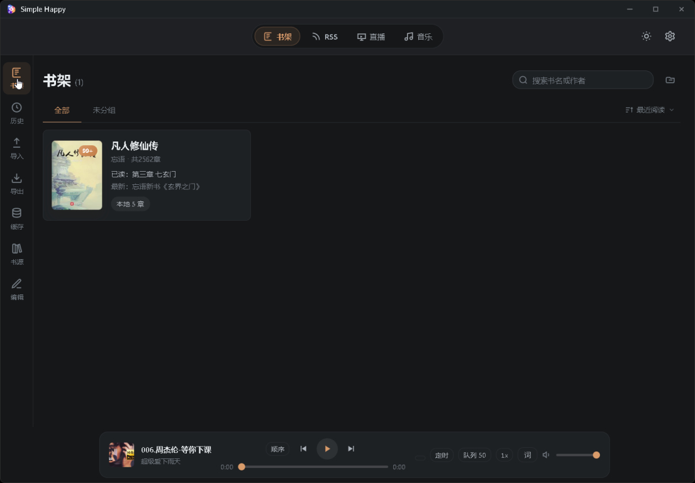
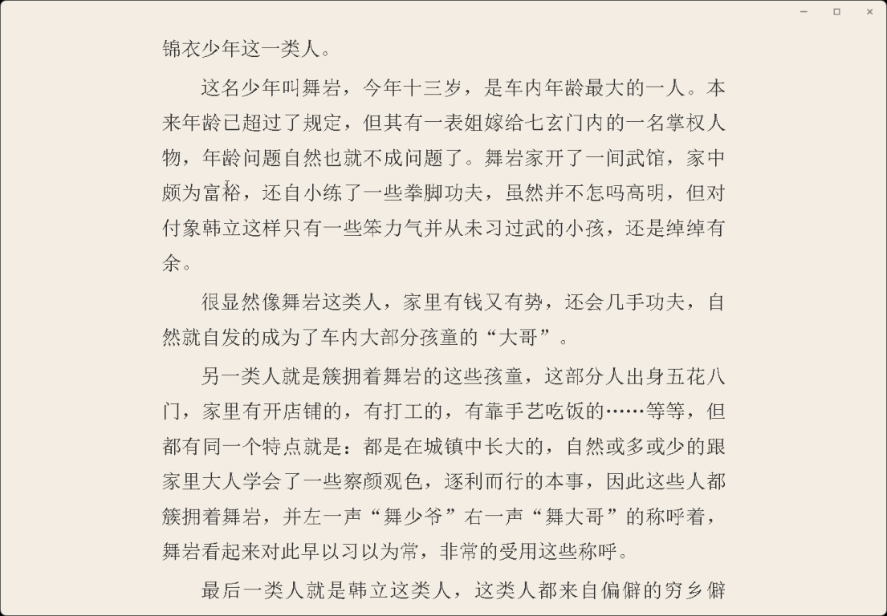
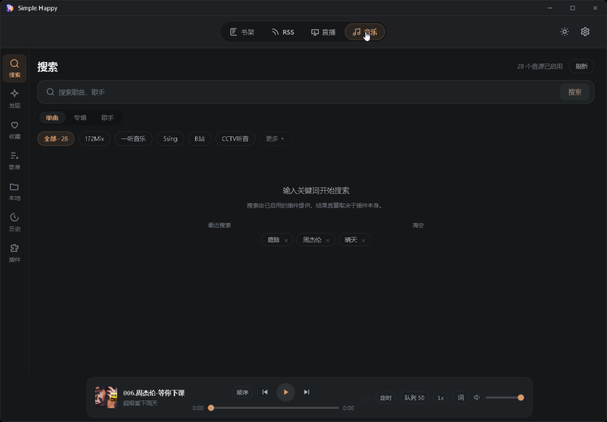

# Simple Happy

[](LICENSE)
[](https://www.rust-lang.org/)
[](https://v2.tauri.app/)
[](https://vuejs.org/)

> 一款**本地优先**的桌面客户端：小说、RSS、音乐、直播四合一，数据全部保存在自己的设备里，没有后端、没有账号、没有广告。

Simple Happy 基于 Rust + Tauri v2 + Vue 3 构建，支持 Windows、macOS、Linux。核心设计目标是让所有功能都以单机方式运行——书源、直播间、音乐插件、RSS 订阅都是用户自己配置的来源，应用本身不提供、不存储、不分发任何版权内容。

项目源自 [Legado（阅读）](https://github.com/Rimchars/legado) 的桌面移植线 [reader](https://github.com/hectorqin/reader) 与 [reader-rust](https://github.com/givenge/reader-rust)，并在此基础上扩展了四平台直播、MusicFree 音乐插件宿主等模块。详见 [NOTICE.md](NOTICE.md)。

> [!IMPORTANT]
> Simple Happy 不内置任何书籍、音视频内容或 RSS 文章。安装包随附的**书源规则**（701 条）、**MusicFree 音源插件**（24 个）与 **RSS 订阅源**（13 条）只是「来源配置模板」，用来说明去哪里取数据，本身不包含任何版权内容；用户可在应用内随时删除或替换。请确保你访问的内容已获得合法授权。

---

## ✨ 功能矩阵

| 模块 | 能力 |
|------|------|
| 📖 **小说** | Legado 书源 + 本地 TXT/EPUB/PDF、书源导入/编辑/测试、多源搜索、章节缓存、主题/排版、WebDAV 同步；左侧栏一键切换「小说 / 历史」视图，历史页含统计卡片、**16 周阅读热力图**与搜索；**本地划线**（选区菜单一键划线/取消）、**听书句高亮 + 从本段听 + 章末续读**；顶部导航顺序为 小说 / RSS / 音乐 / 直播 |
| 🎬 **直播** | B 站 / 虎牙 / 斗鱼 / 抖音 四平台、分区列表/搜索/房间详情、WebView2 + hls.js / flv.js 播放、实时弹幕 + **飘屏弹幕层（开关持久化 + 合成层动画）**、多线路容灾自动切换、**断流自愈（指数退避重连 + 同画质线路切换 + FLV 卡顿重建）**、**B 站扫码登录 + 原画/蓝光等登录清晰度**、**虎牙蓝光8M/4M 多档清晰度**、**后端 `/liveHls` HLS 代理（自动换线路 + 刷新签名，彻底解决虎牙 CDN 随机 403 导致的 10 秒断流）**、**分类页视觉补齐（抖音/虎牙无图标时 HSL 渐变 fallback、稀疏分区合并为"其他分类"）**、弹幕关键词/正则屏蔽、醒目留言横幅、观看历史、直播间链接解析跳转、关注列表定时自动刷新、开播时长显示 |
| 🎵 **音乐** | MusicFree CJS 插件宿主（每插件独立 OS 线程 + rquickjs）、**随包内置 24 个音源插件（与桌面版实际启用的音源一致，首启自动安装，覆盖 QQ/网易云/酷狗/酷我/咪咕/汽水/B站/番茄等）**、插件本地批量安装/网络直链安装/`.json` 订阅清单一键更新、插件排序与说明、单曲/专辑/歌手/歌单搜索、榜单与推荐歌单发现页、**全局播放条（跨页面常驻 + 退出后恢复队列与进度 + 可折叠）**、**播放条收藏/加歌单按钮**、**封面点击进入窗口内全屏 Now Playing（旋转封面 + 滚动歌词 + 进度条 + 控制）**、播放模式/倍速/播放队列/音质降级换源/定时关闭、歌词同步（偏移/字号可调）、收藏/歌单/播放历史、链接导入、插件用户变量与在线更新、512MB LRU 音乐缓存、本地 mp3/flac/m4a 导入（lofty 元数据）、**B 站多 P 合集自动展开成完整歌单队列** |
| 📰 **RSS** | Feed 导入与订阅、文章阅读、与小说最近阅读记录统一时间线、**自动抓取全文**（启发式识别 summary → density-based 容器提取 → 清洗 → 站内链接拦截，不再跳到系统浏览器）、**阅读区宽屏模式**（一键隐藏文章列表、铺满、持久化）、**内置 13 条主流订阅源（少数派 / 阮一峰 / V2EX / IT之家 / cnBeta / 机核 / BBC 中文 / 纽约时报中文网 / The Verge 等，均实测可用）** |
| 🛠️ **工具** | 备份/恢复（兼容 Legado ZIP + JSON，支持**覆盖 / 合并**两种恢复方式）、净化规则、替换规则、桌面背景、全局老板键、窗口状态持久化、**应用内运行日志**（级别/关键词筛选、复制、导出 TXT、清空）与**加载诊断采样**（正文/直播各阶段耗时、错误码，脱敏写入日志） |

### 小说界面


### 阅读界面


### 直播界面


### 音乐界面


---

## 🚀 快速开始

1. 前往 [GitHub Releases](https://github.com/xmlcjc/simple-happy/releases) 下载当前系统对应的安装包或便携包。
2. **安装包 / 便携包**首次启动都会自动准备数据：书库为空时复制随包分发的种子数据库（**701 条书源 + 13 条 RSS 订阅源**），并安装随包的 **24 个 MusicFree 音源插件**（只装一次，之后不再覆盖你手动更新过的插件）。
3. 进入「小说 → 书源」查看/管理已导入的书源；「音乐 → 搜索」可直接选平台搜索，也可在「音乐 → 插件」自行增删/更新音源。
4. 直播模块无需额外配置，打开顶部「直播」tab 即可浏览 B 站 / 虎牙 / 斗鱼 / 抖音的分区；B 站可在「设置 → 直播」扫码登录解锁更高清晰度。
5. RSS 订阅在「主页 → RSS 源」中查看，已内置少数派、IT之家、BBC 中文等 13 条可用的主流订阅源。

---

## 🧱 技术栈

| 层 | 技术 |
|----|------|
| **桌面壳** | Tauri v2（各平台原生 WebView：Windows WebView2 / macOS WKWebView / Linux WebKitGTK） |
| **前端** | Vue 3 + TypeScript + Pinia + Vue Router + Vite 8 |
| **媒体** | hls.js / flv.js（直播）、echarts（统计）、pdfjs-dist（PDF）、opencc-js（简繁转换） |
| **本地核心** | Rust + Tokio + SQLx + SQLite + reqwest（rustls）+ rquickjs（书源/音乐插件 JS）+ quick-xml / scraper / regex / jsonpath_lib（规则解析 + RSS 正文提取）+ tower-http（HLS 代理路由） |
| **直播弹幕** | tokio-tungstenite（WebSocket），Windows 斗鱼弹幕单独 native-tls（TLS 套件原因） |
| **元数据** | lofty（本地音乐 ID3/FLAC 标签）、pdf-extract（PDF 文本提取） |
| **插件宿主** | 每插件独占 OS 线程（Runtime/Context 非 Send）+ 独立 current-thread tokio runtime 做 HTTP 桥（避免 block_on 挂死） |

### 主要目录

| 目录 | 说明 |
|------|------|
| `frontend/` | Vue 3 桌面界面、状态管理、前端单元测试 |
| `src/api/` | Tauri 命令（book / live / music / rss 等）、自定义协议 `reader://` |
| `src/app/` | 应用配置、启动流程、窗口状态持久化 |
| `src/service/` | 书架、直播（四平台适配 + 弹幕 + `/liveHls` 代理）、音乐（插件宿主 + 曲库）、RSS（全文提取）、听书等业务逻辑 |
| `src/parser/` | CSS / JSONPath / XPath / 正则 / JavaScript 五合一解析引擎 |
| `src/crawler/` | HTTP 客户端、请求头规则、Cookie 存储 |
| `src/storage/` | SQLite + sqlx 嵌入迁移（0001~0014）、文件缓存、数据目录 |
| `desktop/src-tauri/` | Tauri 入口、托盘、单实例、NSIS 安装脚本、平台适配 |
| `desktop/src-tauri/builtin-music-plugins/` | 随包分发的 24 个 MusicFree 音源插件（与桌面版实际启用的音源一致），首启自动安装到 `${storage}/music-plugins` |
| `scripts/` | 桌面端构建脚本 |
| `vendor/` | 本地补丁过的第三方依赖（`pdf-extract` 补 GBK CMap、`tao` 修 Windows 全屏黑边） |
| `seed/` | 便携包使用的书源/RSS 种子数据库（不入库，仅 Release 打包时注入） |

---

## 🏗️ 构建与开发

环境要求：**Node.js 22+**、**Rust 1.80+**、Tauri v2 对应平台的 WebView 运行时。

```bash
# 前端
cd frontend
npm install
npm run dev       # Vite 热更新
npm run build     # 生产构建
npm test          # vitest 单元测试

# 桌面端（Windows）
cd desktop
npm install
npm run dev       # 同时启动 Vite + Tauri 窗口
npm run build     # release 编译 + NSIS 安装包 + 便携包
```

Windows 本地执行前建议：

```powershell
. D:\build\env.ps1       # 设置 JAVA_HOME / PATH
$env:CL = "/utf-8"       # rustc 用 UTF-8 输出
$env:CARGO_BUILD_JOBS = "4"  # 避免杀毒软件并行 race
```

产物位于 `desktop/dist/`：
- `<productName>_<ver>_x64-setup.exe` —— NSIS 安装包
- `simple-happy-portable-v<ver>-win-x64.zip` —— 便携包（含种子数据库与内置音源目录）

### 测试

```bash
cargo test -j 4                   # Rust 库 489+ 单测
cargo test -p reader-desktop      # 桌面端便携目录逻辑
cargo test --test music_plugin    # 音乐插件宿主集成测试（axum mock upstream）
cargo test --test builtin_music_plugins_smoke -- --ignored   # 内置音源真实可用性巡检（需外网）
cd frontend && npm test           # 前端 670+ vitest 用例
```

---

## 📄 开源依赖声明

Simple Happy 基于若干 MIT / Apache-2.0 / BSD / ISC 许可的开源项目构建。完整的第三方依赖清单与许可证类型见 [LICENSE-THIRD-PARTY.md](LICENSE-THIRD-PARTY.md)。

重要的二次开发来源：
- **Legado（阅读）** —— 书源格式、书架数据结构、RSS、备份兼容（MIT）
- **reader / reader-rust** —— Tauri + Rust + Vue 的桌面移植骨架（MIT）
- **MusicFree** —— 音乐插件协议 `module.exports = { platform, search, getMediaSource, getLyric }`，Simple Happy 为其实现了独立的 Rust 宿主（MIT）

详见 [NOTICE.md](NOTICE.md)。

---

## 🔒 隐私与合规

- **纯单机**：没有账号系统、没有服务端、没有遥测。书架、阅读进度、书源配置、音乐收藏全部保存在本机 SQLite + 文件目录。
- **用户即来源**：书源、音乐插件、RSS 订阅均由用户自行配置。安装包随附的书源规则与 MusicFree 插件只是「去哪儿取数据」的配置，不含任何书籍、音频或视频文件，且可在应用内一键删除。
- **网络直连**：书源搜索、直播流、音乐源、RSS 都是桌面端直接请求对应来源，走用户自己的系统代理。
- **合规提醒**：请确保自行导入的书源、音乐插件、RSS、本地文件以及通过本应用访问的内容**均已获得合法授权**，版权与合规责任由用户自行承担。如任何权利人认为本项目相关内容侵犯了其合法权益，请通过 Issues 联系维护者。

---

## 🧑‍🤝‍🧑 参与项目

欢迎提 Issues、PR。提交前请：

1. 跑全部门禁：`cargo test` + `npm test` + `npm run build`。
2. 新增依赖时同步更新 `LICENSE-THIRD-PARTY.md`。
3. 不要在 issue / PR 中贴出 Cookie、Token、私人书源或包含个人数据的备份文件。

---

## 📄 许可

本项目基于 [MIT License](LICENSE) 开源。
